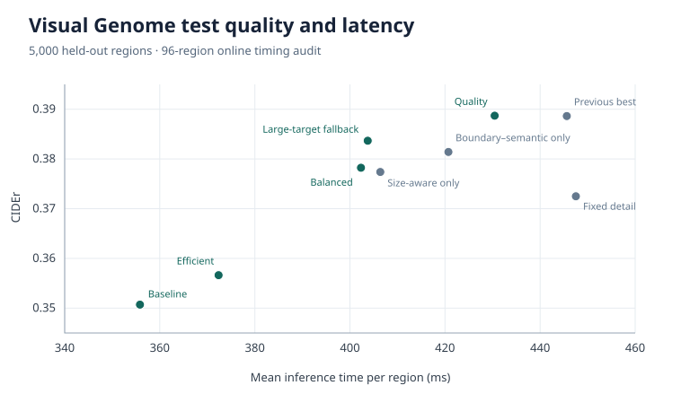

# Adaptive Patch-ioner

Training-free region captioning built on [Patch-ioner](https://github.com/Ruggero1912/Patch-ioner). This project was developed for Peking University's Multimodal Learning course.

The model receives an image and a target box. Balanced decides whether a second, zoomed view is worthwhile using features from the original image. When it uses a crop, it combines the original and zoomed features with a size-dependent weight. All pretrained weights, the full text memory bank, and the decoder stay frozen.

## Results

Held-out Visual Genome evaluation on 5,000 regions in 512 images. Latency is the mean of a 96-region online audit on an RTX 4060 Laptop GPU with 8 GB of memory. It includes image encoding and generation, excluding model loading and image-file reads.

| Method | CIDEr ↑ | Change vs. baseline | Latency |
| --- | ---: | ---: | ---: |
| Baseline | 0.35070 | — | 355.8 ms |
| Fixed detail fusion | 0.37248 | +6.21% | 447.5 ms |
| Previous best | 0.38863 | +10.82% | 445.6 ms |
| Quality | 0.38869 | +10.83% | 430.4 ms |
| Balanced | 0.37823 | +7.85% | 402.3 ms |
| Efficient | 0.35662 | +1.69% | 372.4 ms |
| Large-target fallback | 0.38366 | +9.40% | 403.7 ms |

Balanced used a crop for 60.8% of test regions. Its paired image-level 95% interval for the gain over baseline is [0.01476, 0.04033] CIDEr. Its estimated latency increase is 13.06%, with a 95% interval of [−5.55%, 32.88%]. Quality and the previous best scored almost identically. The large-target fallback reproduced baseline captions for all 1,666 large targets.



- [Full test results](results/main_results.csv)
- [Validation ablations](results/ablation.csv)
- [Method and evaluation protocol](docs/method.md)

## Setup

Use Python 3.10, CUDA-enabled PyTorch 2.5.1, and torchvision 0.20.1. An example Conda environment is shown below.

```sh
conda create -n adaptive-patch-ioner python=3.10
conda activate adaptive-patch-ioner
conda install pytorch=2.5.1 torchvision=0.20.1 pytorch-cuda=12.4 -c pytorch -c nvidia
```

The setup scripts fetch the pinned upstream code, official weights, and example image. Allow about 3 GB for these assets and additional space for the Python environment. Put Java on PATH to use the benchmark's text tokenizer and METEOR.

Linux

```bash
bash scripts/setup.sh
```

Windows PowerShell

```powershell
pwsh -File scripts/setup.ps1
```

## Run

Give the box as `x y width height` in pixels of the input image.

```bash
python scripts/evaluate.py --config configs/baseline.yaml --image assets/examples/dog-frisbee.jpg --bbox 50 50 200 150
python scripts/evaluate.py --config configs/adaptive.yaml --method balanced --image assets/examples/dog-frisbee.jpg --bbox 50 50 200 150
```

To evaluate region captions against local references, supply a dataset manifest and the directory relative to which its image paths resolve.

```bash
python scripts/evaluate.py --config configs/adaptive.yaml --method balanced --manifest data/manifest.json --image-root data --output-dir runs/balanced
```

A manifest contains a `regions` array. Each entry identifies a target box and one or more reference captions.

```json
{
  "regions": [
    {
      "region_id": "example-1",
      "image_id": "example",
      "image_path": "example.jpg",
      "bbox_xywh": [50, 50, 200, 150],
      "references": ["a dog jumping to catch a frisbee"]
    }
  ]
}
```

Use `--method all` to evaluate all nine presets. To reuse an existing copy of the assets, set `PATCH_IONER_ASSET_ROOT` to the directory containing both `assets/` and `upstream/`.

The repository contains the course-project implementation and aggregate results. The data, pretrained weights, and upstream checkout are fetched or supplied locally.


## Reproduce the experiments

Run the commands in this section from the repository root after completing setup. The data preparation script reconstructs three fixed samples from the official DenseCap splits. It downloads the annotation archives and only the 896 selected JPEGs. Use `--verify` for an existing copy, and `--data-dir PATH` to verify data stored elsewhere.

```bash
python experiments/prepare_data.py --download
```

| Split | Regions | Images | Local manifest | Local JPEG directory |
| --- | ---: | ---: | --- | --- |
| Validation | 1,000 | 128 | `data/vg_val_1000/manifest.json` | `data/vg_val_1000/images/` |
| Earlier test | 2,000 | 256 | `data/vg_test_2000/manifest.json` | `data/vg_test_2000/images/` |
| Final test | 5,000 | 512 | `data/vg_test_5000/manifest.json` | `data/vg_test_5000/images/` |

To run the exact nine published test configurations without redoing model selection

```bash
python experiments/refine.py --stage test --use-published-policies --output results/published_test
python experiments/refinement_probe.py --test-timing-audit --root results/published_test
python experiments/refinement_report.py --stages test --root results/published_test
```

The runner checks the final test manifest hash before applying the published lock. The first command generates the quality scores and the initial 24-region online measurements. The second measures a separate 96-region timing sample. Use `results/published_test/test/per_region.csv` for all individual predictions and `results/published_test/test/parts/<method_id>.json` for one method. The identifiers for the size-aware control and previous best are `size_only` and `current_best`.

To rerun validation, ablations, and the original experiment sequence

```bash
python experiments/region_smoke.py --bbox 44 108 273 244 --output results/upstream_smoke.json
python experiments/test_multiscale.py --baseline-reference results/upstream_smoke.json
python experiments/multiscale_experiment.py --manifest data/vg_val_1000/manifest.json --output-dir results/vg_val_1000
python experiments/explore.py --stage all
python experiments/refine.py --stage all
python experiments/refinement_probe.py
python experiments/refinement_probe.py --test-timing-audit
python experiments/refinement_report.py
python experiments/export_results.py
python scripts/plot_results.py --input results/refinement/publication/main_results.csv --output results/refinement/publication/quality_latency.svg
```

`experiments/exploration_online.py` and `experiments/exploration_report.py` replay timing and generate reports for the earlier exploration. `experiments/refinement_history.py` performs the historical prediction and fallback analysis after that exploration. The sweeps save intermediate features and predictions and can resume from their output directories. Use `--resume` for the initial five-mode benchmark. The full sequence selects candidates again from the new validation runs, so local timings and selected roles can differ. The published test command above keeps the reported configurations fixed.

## Repository structure

```text
Adaptive-Patch-ioner/
├── README.md            Project overview, setup, and file index
├── requirements.txt     Python dependencies for inference and metrics
├── .gitignore           Excludes local data, dependencies, and generated runs
├── configs/             Inference presets, search settings, and published locks
├── src/                 Shared model utilities and the published inference path
├── scripts/             Setup, inference, and figure regeneration
├── experiments/         Data preparation, search, evaluation, and reporting
├── results/             Published result tables and locally generated benchmark outputs
├── figures/             Published quality–latency plot
└── docs/                Method and evaluation details
```

### Configuration files

| File | Purpose |
| --- | --- |
| [`configs/baseline.yaml`](configs/baseline.yaml) | Runs the original Patch-ioner model. |
| [`configs/adaptive.yaml`](configs/adaptive.yaml) | Defines the nine released methods and defaults to Balanced for single-box inference. |
| [`configs/exploration.json`](configs/exploration.json) | Sets the seed, split paths, search budget, metrics, and candidate groups for the earlier study. |
| [`configs/refinement.json`](configs/refinement.json) | Sets the refinement splits, seeds, metrics, timing budget, and bootstrap settings. |
| [`configs/exploration_published_lock.json`](configs/exploration_published_lock.json) | Records the earlier test policies, including the fixed comparator used in refinement. |
| [`configs/refinement_published_lock.json`](configs/refinement_published_lock.json) | Records the final nine policies, role assignments, and test manifest fingerprint. |

### Core source files

| File | Purpose |
| --- | --- |
| [`src/multiscale.py`](src/multiscale.py) | Loads the frozen upstream model and implements box geometry, crop preparation, and original/detail/context feature extraction. |
| [`src/size_aware.py`](src/size_aware.py) | Maps patch size signals to fusion weights and evaluates pre-crop selection rules. |
| [`src/boundary_semantic.py`](src/boundary_semantic.py) | Pools patch features using target overlap, position, and semantic similarity. |
| [`src/visual_features.py`](src/visual_features.py) | Runs image preprocessing and visual patch encoding and converts region signals into tensors. |
| [`src/refinement_features.py`](src/refinement_features.py) | Maps full-image and crop coordinates to their feature grids and connects the inference presets to the pooling functions. |
| [`src/region_inference.py`](src/region_inference.py) | Runs a released method for one box, queries DeCap memory, generates the caption, and measures latency and peak GPU allocation. |
| [`src/vg_metrics.py`](src/vg_metrics.py) | Tokenizes and scores paired predictions and references and writes metric tables. |

### Setup and everyday commands

| File | Purpose |
| --- | --- |
| [`scripts/setup.sh`](scripts/setup.sh) | Launches setup on Linux. |
| [`scripts/setup.ps1`](scripts/setup.ps1) | Launches setup from Windows PowerShell. |
| [`scripts/setup_assets.py`](scripts/setup_assets.py) | Installs dependencies and fetches or verifies pinned upstream code and model assets. |
| [`scripts/evaluate.py`](scripts/evaluate.py) | Runs single-image inference or scores the released methods on a local region manifest. |
| [`scripts/plot_results.py`](scripts/plot_results.py) | Rebuilds the quality–latency SVG from a main results CSV. |

### Experiment files

| File | Purpose |
| --- | --- |
| [`experiments/_paths.py`](experiments/_paths.py) | Resolves repository and configuration paths and loads shared source modules. |
| [`experiments/prepare_data.py`](experiments/prepare_data.py) | Coordinates local reconstruction and hash verification of all three Visual Genome sets. |
| [`experiments/vg_subset.py`](experiments/vg_subset.py) | Loads source annotations and creates the stratified 1,000-region validation manifest. |
| [`experiments/vg_heldout.py`](experiments/vg_heldout.py) | Builds the earlier 2,000-region test manifest with disjoint validation images. |
| [`experiments/vg_final_test.py`](experiments/vg_final_test.py) | Builds the final 5,000-region test manifest while excluding images used by earlier runs. |
| [`experiments/region_smoke.py`](experiments/region_smoke.py) | Checks the pinned upstream model on the example image and records its reference output. |
| [`experiments/test_multiscale.py`](experiments/test_multiscale.py) | Checks coordinate handling, upstream parity, empty-context fallback, and GPU memory behavior. |
| [`experiments/multiscale_experiment.py`](experiments/multiscale_experiment.py) | Runs the initial five-mode comparison and provides manifest and checkpoint utilities. |
| [`experiments/explore.py`](experiments/explore.py) | Screens and validates the earlier candidate grid, selects a policy, and evaluates the earlier test set. |
| [`experiments/exploration_methods.py`](experiments/exploration_methods.py) | Defines earlier candidate settings, geometric signals, patch aggregation, and fusion rules. |
| [`experiments/exploration_features.py`](experiments/exploration_features.py) | Encodes full images and crops in batches and caches their features for the earlier search. |
| [`experiments/exploration_decode.py`](experiments/exploration_decode.py) | Projects cached features, decodes captions in batches, and reranks earlier caption candidates. |
| [`experiments/exploration_online.py`](experiments/exploration_online.py) | Measures single-region latency on the earlier experiment stages. |
| [`experiments/exploration_report.py`](experiments/exploration_report.py) | Builds leaderboards, plots, caption examples, and paired bootstrap intervals for the early study. |
| [`experiments/refine.py`](experiments/refine.py) | Runs refinement screens, ablations, and test evaluations or replays the published test lock. |
| [`experiments/refinement_policies.py`](experiments/refinement_policies.py) | Defines refinement grids and calibrates crop-selection policies. |
| [`experiments/refinement_selection.py`](experiments/refinement_selection.py) | Selects validation survivors and assigns Quality, Balanced, and Efficient roles. |
| [`experiments/refinement_features.py`](experiments/refinement_features.py) | Implements lab-only pooling and crop variants used during the refinement search. |
| [`experiments/refinement_cache.py`](experiments/refinement_cache.py) | Stores original and crop features and decoder confidence signals for resumable runs. |
| [`experiments/refinement_confidence.py`](experiments/refinement_confidence.py) | Scores text-memory matches, token uncertainty, and caption reranking signals. |
| [`experiments/refinement_online.py`](experiments/refinement_online.py) | Times paired single-region calls and records crop activity, memory, and caption agreement. |
| [`experiments/refinement_probe.py`](experiments/refinement_probe.py) | Measures screening overhead and performs the separate 96-region test timing audit. |
| [`experiments/refinement_history.py`](experiments/refinement_history.py) | Analyzes historical predictions and estimates changes from fallback policies. |
| [`experiments/refinement_report.py`](experiments/refinement_report.py) | Exports refinement rankings, paired intervals, and online quality–latency comparisons. |
| [`experiments/export_results.py`](experiments/export_results.py) | Rebuilds the publication-format test and ablation CSVs from completed refinement runs. |

### Results, figures, and documentation

| File | Purpose |
| --- | --- |
| [`results/main_results.csv`](results/main_results.csv) | Holds all nine test results, size-group scores, confidence intervals, and 96-region timings. |
| [`results/ablation.csv`](results/ablation.csv) | Holds validation ablations with overall and size-group scores. |
| [`figures/quality_latency.svg`](figures/quality_latency.svg) | Plots the released test results against audited online latency. |
| [`docs/method.md`](docs/method.md) | Describes the fusion method, frozen presets, data splits, and evaluation protocol. |

Setup and data preparation create `upstream/`, `assets/`, and `data/` locally. Experiment-generated predictions and caches are written under `results/`. User-selected single runs can write to `runs/`. These generated files are covered by `.gitignore`.

## Upstream

This project uses the official Talk2DINO and DeCap checkpoint and builds on [One Patch to Caption Them All: A Unified Zero-Shot Captioning Framework](https://arxiv.org/abs/2510.02898), Bianchi et al. The setup script pins Patch-ioner to [commit 34d8130](https://github.com/Ruggero1912/Patch-ioner/tree/34d8130dafba0e4bb148bd0912c4a9186e398a05).
